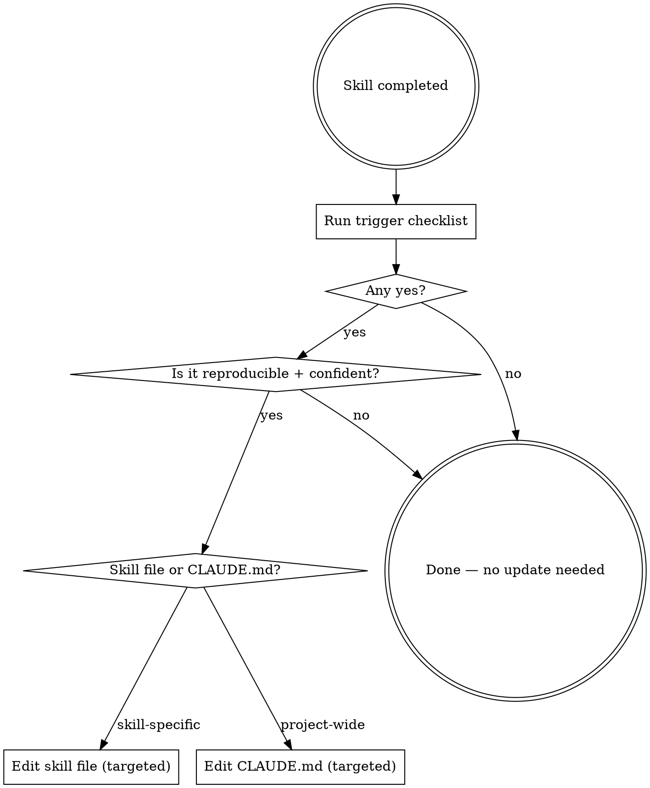

# Skill Self-Improvement Protocol

## Overview

Skills and CLAUDE.md improve incrementally — each run is a chance to make the next run more accurate. This protocol defines when an update is worth making and how to make it without degrading quality.

## Trigger Checklist

After a skill completes, run through these questions. One "yes" = update.

**For the skill file:**

- [ ] Found a pattern or anomaly the skill's queries/steps would have missed?
- [ ] Found a threshold that was wrong for this system (too tight, too loose)?
- [ ] Discovered a new table, field, or constant added to the codebase?
- [ ] A step produced consistent false positives and needs a caveat?
- [ ] Found a better query or approach that gives clearer signal?
- [ ] Encountered an edge case the skill's common-mistakes section doesn't cover?

**For CLAUDE.md:**

- [ ] Discovered a project-wide invariant not already documented there?
- [ ] Found that an existing CLAUDE.md rule is outdated or wrong?
- [ ] Observed a pattern in how the team makes decisions (architecture, naming, workflow)?
- [ ] Found a non-obvious constraint (infra, compliance, scale) that should inform all future work?

**Skip if:**

- The finding was a one-off, not a repeatable pattern
- It's already covered (in the skill or CLAUDE.md)
- You're less than 80% confident it generalises beyond this run
- It's session-specific context (task state, PR numbers, current bugs)

---

## How to Update a Skill File

**Targeted edits only — never rewrite whole sections.**

```
Append to a relevant existing section using Edit tool:
- New query → add under the appropriate numbered section
- New threshold → update the Thresholds table row; add inline comment with date + reason
- New edge case → append to Common Mistakes table
- New caveat → add a "-- Note:" inline comment next to the affected step
```

**Format for threshold changes:**

```sql
-- Threshold updated YYYY-MM-DD: changed from X to Y
-- Reason: observed actual system data showed [brief rationale]
```

**Format for new findings:**

```markdown
**Nx. [Finding title]** _(discovered YYYY-MM-DD)_
[query or step]
-- [what to flag and why]
```

**Quality gate before committing an edit:**

- The new content follows the style of existing content (same heading level, same comment format)
- It adds signal, not noise (would a future run genuinely benefit?)
- It doesn't duplicate anything already there
- It's a permanent truth, not a temporary observation

---

## How to Update CLAUDE.md

CLAUDE.md is the project's source of truth for invariants. Updates follow the same conservative standard.

**Add to the relevant existing section** (Database tables, Key rules, etc.) — don't create new top-level sections unless the finding doesn't fit anywhere.

**Format:**

```markdown
- [One-line invariant or rule] — discovered during [brief context]
```

**Never add:**

- Task-specific state ("currently migrating X")
- Bug descriptions ("there's a bug in Y")
- Duplicate content already expressed in a subdirectory CLAUDE.md
- Anything derivable by reading the code (put it in comments instead)

---

## Decision Flow



---

## Common Mistakes

| Mistake                                          | Fix                                                                            |
| ------------------------------------------------ | ------------------------------------------------------------------------------ |
| Rewriting a whole section instead of appending   | Always use Edit with targeted `old_string` → `new_string`                      |
| Adding one-off observations as permanent rules   | Apply the reproducibility gate — skip if it won't recur                        |
| Updating thresholds without noting the reason    | Always add a dated inline comment explaining why                               |
| Adding to CLAUDE.md what belongs in a skill      | CLAUDE.md = project invariants; skill files = domain checks                    |
| Making updates mid-skill (before results are in) | Only update after the skill fully completes and results are known              |
| Removing existing content that "seems wrong"     | Only remove if you have strong evidence it's incorrect — prefer adding caveats |
