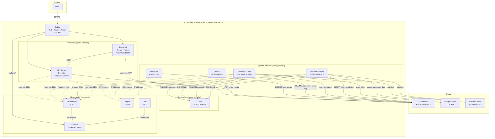
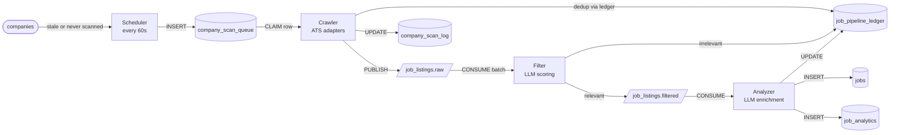

# JobRadar — Architecture

## System Map

---

## Pipeline — Data Flow

---

## CI

GitHub Actions enforces lint, type-check, unit tests, and (nightly + on infra PRs) integration tests against the branch. Image builds and deploys are run manually from the developer machine via `make k8s-build` / `make k8s-up`.

| Workflow                            | Trigger                      | Purpose                                                             |
| ----------------------------------- | ---------------------------- | ------------------------------------------------------------------- |
| `.github/workflows/lint.yml`        | PR to `main`                 | golangci-lint (diff against `main`), ESLint, TypeScript check       |
| `.github/workflows/integration.yml` | Nightly + PRs touching infra | `//go:build integration` tier — Postgres/Kafka/Redis testcontainers |

---

## Database Tables

| Table                     | Written by                                                | Read by            | Purpose                                                                                       |
| ------------------------- | --------------------------------------------------------- | ------------------ | --------------------------------------------------------------------------------------------- |
| `companies`               | API (admin)                                               | Scheduler, Crawler | Tracked company catalog (operational columns dropped; scan config in `company_scan_settings`) |
| `company_scan_settings`   | API (admin)                                               | Scheduler, Crawler | Per-company scan config; companies without a row are skipped                                  |
| `company_scan_queue`      | Scheduler, API                                            | Crawler            | Durable work queue — one row per pending scan                                                 |
| `company_scan_log`        | Crawler                                                   | API / Dashboard    | Per-run scan summary                                                                          |
| `job_pipeline_ledger`     | Crawler, Filter, Analyzer                                 | Crawler            | Dedup + pipeline state tracking                                                               |
| `jobs`                    | Analyzer                                                  | API                | Global job rows (renamed from `job_feed`); per-user state in `user_job_state`                 |
| `user_job_state`          | API                                                       | API                | Per-user overlay: status, notes, saved_at, applied_at, dismissal reason/note                  |
| `job_analytics`           | Analyzer                                                  | Insights           | Append-only enriched snapshot; never deleted                                                  |
| `job_application_tracker` | API                                                       | API                | Application stage history per job; `user_id NOT NULL`                                         |
| `users`                   | API (`RequireIdentity` / `service/user`)                  | API                | Registered users — id, email (citext), display_name, status                                   |
| `roles`                   | Migration `043` (seeded)                                  | API                | RBAC0 role catalog — `user`, `admin`                                                          |
| `user_roles`              | API (`service/role`, `RequireIdentity` lazy provisioning) | API                | User↔role join (composite PK)                                                                 |
| `admin_audit_log`         | `AuditAdminMutation` middleware (`service/audit`)         | API                | Append-only admin audit trail                                                                 |

---

## Component Reference

| Component           | Binary           | Internal port             | External            | Helm chart | Memory |
| ------------------- | ---------------- | ------------------------- | ------------------- | ---------- | ------ |
| API Server          | `/app/api`       | `:8080` / `:9100` metrics | NodePort **:30080** | jobradar   | 256 MB |
| Scheduler           | `/app/scheduler` | `:9101` metrics           | —                   | jobradar   | 128 MB |
| Crawler             | `/app/crawler`   | `:9101` metrics           | —                   | jobradar   | 3 GB   |
| Filter              | `/app/filter`    | `:9101` metrics           | —                   | jobradar   | 256 MB |
| Analyzer            | `/app/enricher`  | `:9101` metrics           | —                   | jobradar   | 256 MB |
| Migration runner    | `/app/migrate`   | —                         | —                   | jobradar   | —      |
| Frontend (Nginx)    | —                | `:8080`                   | NodePort **:30300** | jobradar   | 64 MB  |
| Kafka               | —                | `:9092`                   | —                   | jobradar   | 1 GB   |
| Upstash Redis       | —                | `:6379` (TLS)             | Managed (external)  | —          | —      |
| Grafana             | —                | `:3000`                   | NodePort **:30001** | obs        | —      |
| Prometheus          | —                | `:9090`                   | port-forward        | obs        | —      |
| Loki                | —                | `:3100`                   | —                   | obs        | —      |
| Jaeger              | —                | `:16686`                  | port-forward        | obs        | —      |
| supabase-audit-sync | —                | —                         | —                   | obs        | 64 MB  |
| Caddy               | —                | `:80/:443`                | Public (prod)       | —          | —      |
