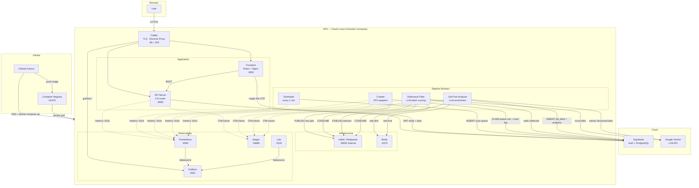
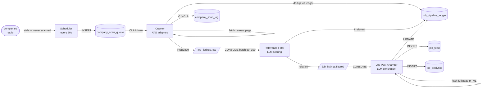
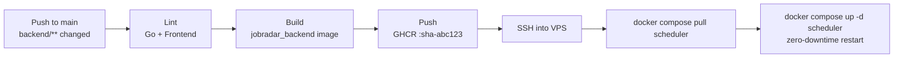

# JobRadar — System Architecture

## System Map

---

## Job Pipeline — Data Flow

---

## CI/CD Pipeline (Scheduler)

---

## Database Tables

| Table | Written by | Read by | Purpose |
|---|---|---|---|
| `companies` | API | Scheduler, Crawler | Tracked company catalog |
| `company_scan_queue` | Scheduler, API | Crawler | Durable work queue — one row per pending scan |
| `company_scan_log` | Crawler | API / Dashboard | Per-run scan summary (fetched, new, errors) |
| `job_pipeline_ledger` | Crawler, Filter, Analyzer | Crawler | Dedup + pipeline state tracking |
| `job_feed` | Analyzer | API | Active jobs — new / saved / applied / dismissed |
| `job_analytics` | Analyzer | API / Insights | Append-only enriched job snapshot; never deleted |
| `job_application_tracker` | API | API | Application stage history per job |
| `job_dismissal_log` | API | API | Dismiss log with reason and note |

---

## Component Reference

| Component | Binary | Port | Profile | Memory |
|---|---|---|---|---|
| API Server | `/app/api` | `:8080` | `app` | 128 MB |
| Scheduler | `/app/scheduler` | `:9101` | `workers` | 128 MB |
| Crawler | `/app/crawler` | `:9102` | `workers` | 1 GB (Chromedp) |
| Relevance Filter | `/app/filter` | `:9103` | `workers` | 128 MB |
| Job Post Analyzer | `/app/enricher` | `:9104` | `workers` | 128 MB |
| Migration runner | `/app/migrate` | — | `app` | — |
| Frontend (Nginx) | — | `:3000` | `app` | — |
| Caddy | — | `:80/:443` | `proxy` | — |
| Kafka (Redpanda) | — | `:29092` | `infra` | 256 MB |
| Redis | — | `:6379` | `infra` | — |
| Prometheus | — | `:9090` | `obs` | — |
| Grafana | — | `:3001` | `obs` | — |
| Loki | — | `:3100` | `obs` | — |
| Jaeger | — | `:16686` | `obs` | — |

---

## Key Design Decisions

- **All binaries ship in one image** (`jobradar_backend`) — built once, deployed by selecting the command (`/app/api`, `/app/scheduler`, etc.)
- **Kafka is the pipeline bus** — no direct worker-to-worker calls; failures recorded in `job_pipeline_ledger`, not re-queued
- **PostgreSQL is Supabase-hosted** — auth and DB in one managed service; no self-hosted Postgres container
- **Caddy is the sole public ingress** — all services bind loopback internally; only Caddy binds `:80`/`:443`
- **LLM rate limiting via Redis** — Filter and Analyzer share a Redis-backed slot pool to stay within Gemini quotas
