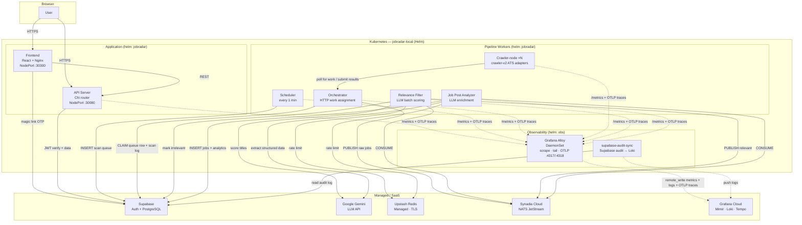
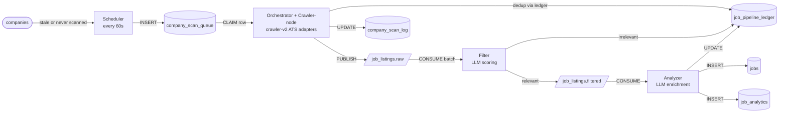

# JobRadar — Architecture

## System Map

---

## Pipeline — Data Flow

---

## CI

GitHub Actions enforces lint, type-check, and unit tests on PRs and push to `main`. On push to `main`, changed service images are built and deployed automatically to OCI nodes.

| Workflow                             | Trigger             | Purpose                                                                  |
| ------------------------------------ | ------------------- | ------------------------------------------------------------------------ |
| `.github/workflows/ci.yml`           | PR + push to `main` | golangci-lint, ESLint, TypeScript check, Go unit tests, Codecov on push  |
| `.github/workflows/release.yml`      | push to `main`      | Detect changes → build per-service images → deploy INFRA + APP OCI nodes |
| `.github/workflows/deploy.yml`       | Manual dispatch     | Rollback: pick node (infra/app/both) + Helm revision                     |
| `.github/workflows/fix-app-node.yml` | Manual dispatch     | Run `oci-k3s-netfix.sh` on the APP node when k3s is not Ready            |

---

## Database Tables

| Table                     | Written by                                                | Read by                 | Purpose                                                                                       |
| ------------------------- | --------------------------------------------------------- | ----------------------- | --------------------------------------------------------------------------------------------- |
| `companies`               | API (admin)                                               | Scheduler, Orchestrator | Tracked company catalog (operational columns dropped; scan config in `company_scan_settings`) |
| `company_scan_settings`   | API (admin)                                               | Scheduler, Orchestrator | Per-company scan config; companies without a row are skipped                                  |
| `company_scan_queue`      | Scheduler, API                                            | Orchestrator            | Durable work queue — one row per pending scan                                                 |
| `company_scan_log`        | Orchestrator                                              | API / Dashboard         | Per-run scan summary                                                                          |
| `job_pipeline_ledger`     | Orchestrator, Filter, Analyzer                            | Orchestrator            | Dedup + pipeline state tracking                                                               |
| `jobs`                    | Analyzer                                                  | API                     | Global job rows (renamed from `job_feed`); per-user state in `user_job_state`                 |
| `user_job_state`          | API                                                       | API                     | Per-user overlay: status, notes, saved_at, applied_at, dismissal reason/note                  |
| `job_analytics`           | Analyzer                                                  | Insights                | Append-only enriched snapshot; never deleted                                                  |
| `job_application_tracker` | API                                                       | API                     | Application stage history per job; `user_id NOT NULL`                                         |
| `users`                   | API (`RequireIdentity` / `service/user`)                  | API                     | Registered users — id, email (citext), display_name, status                                   |
| `roles`                   | Migration `043` (seeded)                                  | API                     | RBAC0 role catalog — `user`, `admin`                                                          |
| `user_roles`              | API (`service/role`, `RequireIdentity` lazy provisioning) | API                     | User↔role join (composite PK)                                                                 |
| `admin_audit_log`         | `AuditAdminMutation` middleware (`service/audit`)         | API                     | Append-only admin audit trail                                                                 |

---

## Component Reference

| Component           | Binary              | Internal port              | External            | Helm chart | Mem limit       |
| ------------------- | ------------------- | -------------------------- | ------------------- | ---------- | --------------- |
| API Server          | `/app/api`          | `:8080` / `:9100` metrics  | NodePort **:30080** | jobradar   | 128 MB          |
| Scheduler           | `/app/scheduler`    | `:9101` metrics            | —                   | jobradar   | 128 MB          |
| Orchestrator        | `/app/orchestrator` | `:8082` / `:9104` metrics  | —                   | jobradar   | 128 MB          |
| Crawler-node        | `/app/crawler-node` | `:9105` metrics            | —                   | jobradar   | 64 MB (per pod) |
| Filter              | `/app/filter`       | `:9101` metrics            | —                   | jobradar   | 128 MB          |
| Analyzer            | `/app/enricher`     | `:9101` metrics            | —                   | jobradar   | 128 MB          |
| Migration runner    | `/app/migrate`      | —                          | —                   | jobradar   | 128 MB          |
| Frontend (Nginx)    | —                   | `:8080`                    | NodePort **:30300** | jobradar   | 64 MB           |
| NATS JetStream      | —                   | `tls://connect.ngs.global` | Managed (Synadia)   | —          | —               |
| Upstash Redis       | —                   | `:6379` (TLS)              | Managed (external)  | —          | —               |
| Grafana Alloy       | —                   | `:4317`/`:4318` OTLP       | DaemonSet           | obs        | 384 MB          |
| supabase-audit-sync | —                   | —                          | —                   | obs        | 64 MB           |
| Grafana Cloud       | —                   | —                          | SaaS                | —          | —               |
